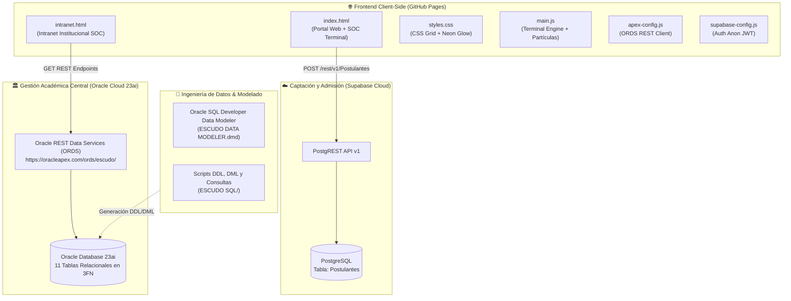
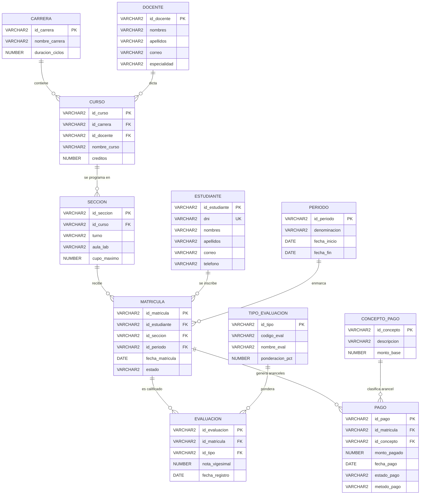

# 🛡️ ESCUDO: Plataforma Institucional, Terminal SOC e Intranet ORDS
## Manual de Arquitectura, Usuario y Guía de Operación del Sistema

> **Estado del despliegue:** Operativo en producción  
> **Versión:** v3.0.0 (Enterprise Cyber-Tactical Edition)  
> **Portal Web Oficial:** [https://alyssunrise-13.github.io/ESCUDO/](https://alyssunrise-13.github.io/ESCUDO/)  
> **Intranet Táctica:** [https://alyssunrise-13.github.io/ESCUDO/intranet.html](https://alyssunrise-13.github.io/ESCUDO/intranet.html)  
> **Motor de Base de Datos:** Oracle Database 23ai + Oracle REST Data Services (ORDS)  
> **Sincronización en la Nube:** Supabase PostgreSQL (Admisión) & Oracle Cloud Infrastructure (Gestión Académica)  
> **Sede académica:** Ayacucho, Perú

> **Consejo de visualización:** Se recomienda utilizar el atajo de zoom `Ctrl` + `-` si desea reducir los márgenes, ya que la interfaz está diseñada con escala táctica de alta accesibilidad para pantallas SOC y personas con dificultades visuales.

---

## 📌 Tabla de Contenidos
1. [Descripción General y Misión](#1-descripción-general-y-misión)
2. [Ecosistema Tecnológico y Arquitectura](#2-ecosistema-tecnológico-y-arquitectura)
3. [Navegación y Accesibilidad Universal (WCAG 2.1 AAA)](#3-navegación-y-accesibilidad-universal-wcag-21-aaa)
4. [Consola Táctica Interactiva (SOC Terminal v2.6.4)](#4-consola-táctica-interactiva-soc-terminal-v264)
5. [Módulo de Admisión y Persistencia en Supabase](#5-módulo-de-admisión-y-persistencia-en-supabase)
6. [Intranet Institucional y Gestión con Oracle Database (ORDS REST)](#6-intranet-institucional-y-gestión-con-oracle-database-ords-rest)
   - 6.1. [Matriz de Control de Acceso por Roles (Clearance Levels)](#61-matriz-de-control-de-acceso-por-roles-clearance-levels)
   - 6.2. [Módulos Operativos de la Dirección Académica](#62-módulos-operativos-de-la-dirección-académica)
   - 6.3. [Endpoints REST de ORDS (Oracle APEX)](#63-endpoints-rest-de-ords-oracle-apex)
7. [Diseño y Modelado Relacional (Data Modeler & SQL)](#7-diseño-y-modelado-relacional-data-modeler--sql)
   - 7.1. [Estructura del Repositorio y Artefactos de Base de Datos](#71-estructura-del-repositorio-y-artefactos-de-base-de-datos)
   - 7.2. [Diccionario y Relaciones de las 11 Tablas](#72-diccionario-y-relaciones-de-las-11-tablas)
   - 7.3. [Restricciones de Integridad y Reglas de Negocio (DDL/DML)](#73-restricciones-de-integridad-y-reglas-de-negocio-ddldml)
8. [Preguntas Frecuentes y Solución de Problemas (FAQ)](#8-preguntas-frecuentes-y-solución-de-problemas-faq)

---

## 1. Descripción General y Misión

**ESCUDO** (*Escuela de Seguridad Cibernética y Unidad de Defensa Operativa*) es un ecosistema tecnológico integral diseñado para la formación de élite, captación vocacional y gobernanza académica en disciplinas críticas de defensa digital e ingeniería de software.

A diferencia de los entornos educativos convencionales, ESCUDO implementa una arquitectura híbrida inspirada en un **Centro de Operaciones de Seguridad (SOC)** militarizado y laboratorios de simulación (*Cyber Range*):
* **Identidad Visual:** Esquema de alto contraste militar/táctico (`#030503` carbón profundo, `#00ff41` verde fósforo terminal, `#111611` contenedores reforzados) con tipografía monoespaciada de precisión (`Courier New`, `Consolas`).
* **Seguridad Defensiva:** Autenticación criptográfica con derivación de hash SHA-256, políticas de bloqueo reactivo contra fuerza bruta, trampas Honeypot anti-bot y validación de tokens JWT sin exposición de credenciales privadas.
* **Gobierno de Datos Integral:** Persistencia desacoplada entre captación de prospectos (PostgreSQL en Supabase) y auditoría institucional relacional de 11 entidades de negocio sobre Oracle Database 23ai vía REST ORDS.

---

## 2. Ecosistema Tecnológico y Arquitectura



* **Frontend:** HTML5 Semántico, CSS3 Vanilla (variables CSS, animaciones GPU y layouts en CSS Grid/Flexbox), JavaScript ES6+ asíncrono sin dependencias pesadas.
* **Librerías Visuales:** `particles.js` (renderizado de nodos interactivos en Canvas) y `Font Awesome 6` (iconografía táctica).
* **Base de Datos Operativa:** Oracle Database 23ai alojada en Oracle Cloud Infrastructure, administrada mediante DBeaver y Oracle APEX.
* **Capa de Integración de Datos:** Oracle REST Data Services (ORDS) con serialización JSON nativa para consumo instantáneo en navegadores.
* **Base de Datos de Captación:** Supabase PostgreSQL con Row Level Security (RLS) y conexión HTTPS / TLS 1.3.

---

## 3. Navegación y Accesibilidad Universal (WCAG 2.1 AAA)

La arquitectura del portal satisface los requerimientos internacionales de accesibilidad web:

* **Enlace de Salto Accesible:** Los usuarios que navegan mediante teclado o lectores de pantalla pueden presionar la tecla `Tab` al cargar el sitio para activar el enlace oculto `.salto-contenido`, transfiriendo el foco directamente al área central.
* **Navegación Fija con Detección Activa:** La barra superior vincula instantáneamente a las secciones `#inicio`, `#admision`, `#carreras`, `#nosotros`, `#resenas` y el acceso directo a la `Intranet`. Mediante `IntersectionObserver`, el menú resalta en tiempo real la sección visible en el viewport.
* **Menú Móvil Colapsable:** En pantallas menores a 768px, la barra se compacta en un botón de hamburguesa accesible que actualiza dinámicamente `aria-expanded` y puede cerrarse mediante la tecla `Escape` o interactuando fuera del menú.
* **Sensibilidad al Movimiento:** Respeto íntegro a usuarios con trastornos vestibulares mediante `@media (prefers-reduced-motion: reduce)`, mitigando o deteniendo animaciones de pulso neón y efectos de escaneo visual.

---

## 4. Consola Táctica Interactiva (SOC Terminal v2.6.4)

En la cabecera del portal público se aloja el emulador interactivo de terminal de comandos tácticos para exploración vocacional guiada.

### 4.1. Indicadores de Telemetría Perimetral
* **Badges de Operación:** Estado del Firewall de borde y nivel de alerta del sistema (*IDS/IPS: DEFCON 4*).
* **Latencia Dinámica:** Temporizador que calcula aleatoriamente la latencia de red simulada (oscilando de 11ms a 15ms).
* **Reloj Neon en Tiempo Real:** Visualización estricta de 24 horas (`hh:mm:ss`) sincronizada con el huso horario local de Ayacucho.

### 4.2. Diccionario de Comandos CLI Soportados

El usuario puede interactuar escribiendo órdenes en la línea de comando con el prompt `escudo@soc:~$` y presionando `Enter` o pulsando los chips de acción rápida:

| Comando | Acción del Sistema |
| :--- | :--- |
| `que_aprendere`, `plan`, `temario` | Imprime de forma secuencial la malla técnica (Hacking Ético, Redes y Cloud, Análisis Forense). |
| `retos_practicos`, `ctf`, `practica` | Detalla la metodología pedagógica militarizada mediante retos *Capture The Flag*. |
| `carreras`, `especialidades` | Desplaza suavemente la pantalla hacia el catálogo curricular de 6 carreras. |
| `admision`, `postular`, `beca` | Realiza un desplazamiento automático al formulario y enfoca el cursor en el campo del nombre. |
| `escanear`, `scan` | Ejecuta un diagnóstico de aptitudes vocacionales y perfil defensivo en la consola. |
| `ayuda`, `help` | Lista el catálogo de directivas disponibles en el terminal. |
| `limpiar`, `clear`, `cls` | Purga el historial del buffer de terminal y reinicia el banner de cabecera. |
| `hack`, `matrix`, `sudo`, `root` | **Easter Egg:** Detona una sobrecarga visual de neón, emite tonos audibles de alerta táctica con la Web Audio API y revela el código de descuento `#HACKER-ESCUDO-2026`. |

---

## 5. Módulo de Admisión y Persistencia en Supabase

El formulario de postulación sustituye las hojas de cálculo tradicionales por un canal seguro conectado directamente a la nube de **Supabase PostgreSQL**.

### 5.1. Reglas de Validación Client-Side
* **Nombre completo:** Longitud regulada de 2 a 120 caracteres alfabéticos con soporte de tildes y diéresis.
* **DNI Peruano:** Verificación rigurosa de exactamente 8 dígitos numéricos mediante `^[0-9]{8}$`.
* **Teléfono Móvil:** De 7 a 15 dígitos numéricos.
* **Correo Electrónico:** Sintaxis estandarizada con validez de dominio (`nombre@organizacion.ext`).
* **Carrera & Modalidad:** Validación obligatoria frente a las especialidades aprobadas de la institución.

### 5.2. Capas de Protección Cibernética
* **Trampa Honeypot:** Campo invisible (`_hp_security_check`) oculto por CSS. Todo bot que llene este campo sufre la anulación silenciosa del paquete sin alterar la base de datos.
* **Control de Frecuencia (Rate Limiting):** A través de `sessionStorage`, se prohíbe el envío continuo con menos de **8 segundos** de ventana entre peticiones para prevenir spam.
* **Sanitización contra XSS:** Neutralización estricta de etiquetas y caracteres de control HTML antes del empaquetado.
* **Verificación de Clave JWT:** El script inspecciona el payload en Base64 para garantizar que solo se utilice el token de lectura/escritura pública restringida (`role: anon`).

---

## 6. Intranet Institucional y Gestión con Oracle Database (ORDS REST)

Ubicada en `intranet.html`, la intranet táctica proporciona el centro de comando integral de la academia, gobernando las 11 entidades relacionales del sistema.

```
+---------------------------------------------------------------------------------------+
|  🛡️ ESCUDO // INTRANET   ● ORDS: CONECTADO    ROL: DIRECCIÓN ACADÉMICA    [CERRAR SESIÓN]  |
+---------------------------------------------------------------------------------------+
| MOTOR RELACIONAL VINCULADO: https://oracleapex.com/ords/escudo/                       |
| [90 Estudiantes] [6 Carreras] [18 Cursos] [18 Secciones] [8 Docentes] [720 Notas] ... |
+---------------------------------------------------------------------------------------+
| [01] ESTUDIANTES & MATRÍCULAS  | [02] CARRERAS & CURSOS  | [03] PLANA DOCENTE         |
| [04] SECCIONES & HORARIOS      | [05] RÚBRICAS & EVAL.   | [06] AUDITORÍA DE PAGOS    |
+---------------------------------------------------------------------------------------+
```

### 6.1. Matriz de Control de Acceso por Roles (Clearance Levels)

El acceso a la intranet opera mediante una arquitectura de seguridad por niveles:

| Rol Operativo | Nivel de Clearance | Estado del Canal | Método de Acceso / Credencial |
| :--- | :---: | :---: | :--- |
| **Estudiantes** | `LVL-1` | 🔒 Restringido | Acceso en mantenimiento por auditoría semestral. |
| **Plana Docente** | `LVL-2` | 🔒 Restringido | Acceso restringido por cierre de actas académicas. |
| **Dirección Académica** | `LVL-4` | 🟢 Operativo | Clave maestra protegida por derivación criptográfica **SHA-256**. |

> **Mecanismo Anti-Fuerza Bruta:** Si un operador introduce una clave errónea en 3 intentos consecutivos, el sistema bloquea inmediatamente la interfaz por un período forzoso de **30 segundos**, informando el incidente en consola con hora exacta.

### 6.2. Módulos Operativos de la Dirección Académica

1. **`[01] Estudiantes & Matrículas`:** Padrón central de los 90 estudiantes matriculados. Incluye motor de búsqueda reactivo en tiempo real (por nombre, DNI o código `EST-xxx`), selector de filtro por carreras y turnos, insignias de rendimiento (`Beca Talento`, `Sobresaliente`, `Aprobado`), modal de ficha detallada del alumno con notas registradas, y herramienta de exportación masiva a formato **CSV**.
2. **`[02] Carreras & Cursos`:** Catálogo de las 6 carreras técnicas de vanguardia y las 18 especialidades curriculares vinculadas a sus respectivos créditos y ciclos de formación.
3. **`[03] Plana Docente`:** Nómina de los 8 instructores y auditores senior titulares con sus códigos operativos, credenciales académicas y cursos asignados.
4. **`[04] Secciones & Horarios`:** Cronograma de las 18 secciones operativas distribuidas en turnos Mañana, Tarde y Noche en los laboratorios tácticos (`Lab-CyberRange`, `Lab-Kernel`, `Lab-NetOps`).
5. **`[05] Rúbricas & Evaluaciones`:** Desglose analítico de las 8 rúbricas oficiales SENATI (FOR1, TA1, TA2, TA3, EP, RUB, PROY, EF) cuya sumatoria ponderada alcanza estrictamente el 100%.
6. **`[06] Auditoría de Pagos`:** Fiscalización financiera de los 135 aranceles emitidos, detallando estados `PAGADO` / `PENDIENTE`, métodos de pago (BCP, Interbank, Yape, Plin), aranceles base y balance de ingresos consolidados.

### 6.3. Endpoints REST de ORDS (Oracle APEX)

Los datos se consumen de forma asíncrona mediante peticiones HTTP REST contra el esquema `escudo` habilitado en Oracle REST Data Services:

```javascript
// Base de API ORDS (Oracle Cloud APEX)
const BASE_ORDS = 'https://oracleapex.com/ords/escudo/';
```

* `GET /estudiante/`: Consulta la lista completa de los 90 estudiantes con sus nombres, DNI, teléfonos y correos institucionales.
* `GET /carrera/`: Retorna las 6 carreras formativas con su duración y campo de acción.
* `GET /curso/`: Detalla los 18 cursos técnicos y su asignación de créditos.
* `GET /docente/`: Provee el registro de los 8 docentes titulares de cátedra.
* `GET /seccion/`: Consulta las 18 secciones académicas y distribución de cupos.
* `GET /matricula/`: Retorna la vinculación de inscripción entre estudiante, sección y período.
* `GET /tipo_evaluacion/`: Especifica las 8 ponderaciones oficiales del reglamento académico.
* `GET /evaluacion/`: Provee los 720 registros de calificaciones vigesimales individuales.
* `GET /concepto_pago/`: Catálogo de los 4 tipos de aranceles (Matrícula, Cuota Mensual, Examen de Certificación, Constancia).
* `GET /pago/`: Relación de los 135 recibos y comprobantes financieros emitidos.
* `GET /periodo/`: Parámetros operativos del período académico activo `2026-II`.

---

## 7. Diseño y Modelado Relacional (Data Modeler & SQL)

La base de datos de ESCUDO fue diseñada y normalizada en **Tercera Forma Normal (3FN)** utilizando la suite profesional **Oracle SQL Developer Data Modeler**.

### 7.1. Estructura del Repositorio y Artefactos de Base de Datos

```
ESCUDO/
├── ESCUDO DATA MODELER.dmd             # Archivo maestro de diseño de Oracle Data Modeler
├── ESCUDO DATA MODELER/                # Estructura del modelo de datos normalizado
│   └── ...                             # Submodelos lógicos, relacionales y tipos de datos
├── ESCUDO SQL/                         # Artefactos y scripts SQL ejecutables
│   ├── ESCUDO.ddl                      # DDL generado automáticamente por Oracle Data Modeler
│   ├── 0_DDL_ESTRUCTURA.sql           # Definición de las 11 tablas con restricciones PK, FK y CHECKs
│   ├── 1_DML_LIMPIO.sql               # Inserción masiva de datos normalizados de producción
│   ├── 2_DML_MODIFICADO.sql           # Modificaciones y escenarios de prueba académica
│   ├── 2_DEMO_Y_CONSULTAS.sql         # Consultas analíticas iniciales
│   ├── 3_DEMO_Y_CONSULTAS.sql         # Consultas avanzadas de auditoría, promedios y balances
│   ├── HABILITAR_ORDS_APEX.sql        # Script PL/SQL para publicar los endpoints REST en ORDS
│   ├── ESCUDOlogico.png               # Diagrama de Entidad-Relación Lógico oficial
│   └── ESCUDOrelacional.png           # Diagrama Físico/Relacional de llaves y dependencias
├── imagenes/                           # Fondos tácticos y recursos visuales institucionales
├── supabase/                           # Scripts SQL de persistencia para la tabla Postulantes
├── apex-config.js                      # Definición de constantes y endpoints ORDS de la intranet
├── intranet.html                       # Panel de control institucional SOC para la Dirección
├── index.html                          # Portal público principal con terminal SOC y catálogo
├── main.js                             # Lógica de terminal, animaciones y formulario de admisión
└── styles.css                          # Sistema de diseño militarizado en verde neón y negro
```

### 7.2. Diccionario y Relaciones de las 11 Tablas



### 7.3. Restricciones de Integridad y Reglas de Negocio (DDL/DML)

* **Calificaciones Vigesimales Estrictas:** Todas las notas registradas en `EVALUACION` están restringidas por la regla de comprobación `CHECK (nota_vigesimal BETWEEN 0 AND 20)`.
* **Ponderación Totalitaria al 100%:** Las ponderaciones de los 8 tipos de evaluación (`FOR1`, `TA1`, `TA2`, `TA3`, `EP`, `RUB`, `PROY`, `EF`) suman exactamente 100%, garantizando promedios justos y auditables.
* **Consistencia de Identidad:** Restricciones de unicidad (`UNIQUE`) en los números de DNI tanto de estudiantes como de postulantes.
* **Estados Financieros y de Turno Validados:** Los turnos se restringen a `('MAÑANA', 'TARDE', 'NOCHE')`, y los cobros a `('PAGADO', 'PENDIENTE', 'ANULADO')`.

---

## 8. Preguntas Frecuentes y Solución de Problemas (FAQ)

**¿Cómo accedo al panel de Dirección Académica en la Intranet?**  
Ingresa a `intranet.html`, haz clic sobre la tarjeta de **Dirección Académica (Nivel 4)**, introduce la clave maestra institucional y presiona el botón de acceso.

**¿Por qué los accesos de Estudiantes y Docentes muestran un aviso de restricción?**  
Por motivos de seguridad institucional y auditoría del cierre de semestre, los módulos `LVL-1` y `LVL-2` se mantienen protegidos con candado temporal para preservar la inmutabilidad de las actas.

**¿Qué ocurre si se agotan los 3 intentos de acceso administrativo?**  
El protocolo de defensa activa deshabilita temporalmente el botón de ingreso por **30 segundos** para contrarrestar ataques automatizados de diccionario.

**¿Dónde se consultan los diagramas relacionales completos?**  
Dentro de la carpeta `ESCUDO SQL/` se encuentran disponibles los archivos en alta resolución:
* `ESCUDOlogico.png`: Diagrama de entidades y atributos conceptuales.
* `ESCUDOrelacional.png`: Esquema físico detallado con todas las claves primarias (PK) y foráneas (FK).

**¿Cómo levantar el backend de Oracle REST Services de forma autónoma?**  
Ejecuta el script `ESCUDO SQL/HABILITAR_ORDS_APEX.sql` dentro del SQL Workshop de tu instancia de Oracle APEX con privilegios de administrador para exponer automáticamente los endpoints bajo el esquema `escudo`.

---

<div align="center">
  <sub>🛡️ <b>ESCUDO</b> — Escuela de Seguridad Cibernética y Unidad de Defensa Operativa · Desarrollado para operaciones de alta disponibilidad y entrenamiento técnico defensivo.</sub>
</div>
